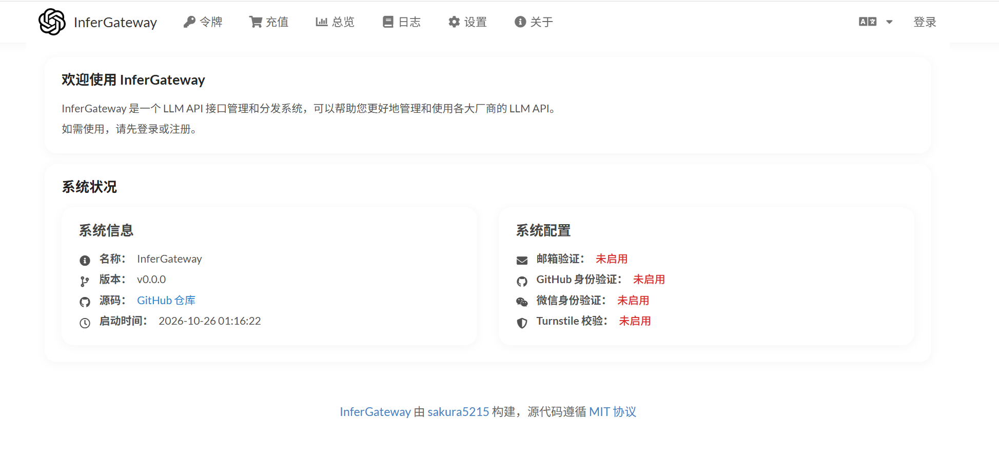
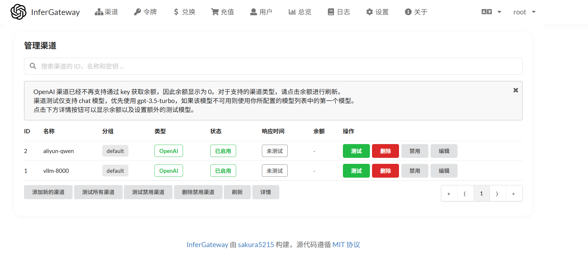
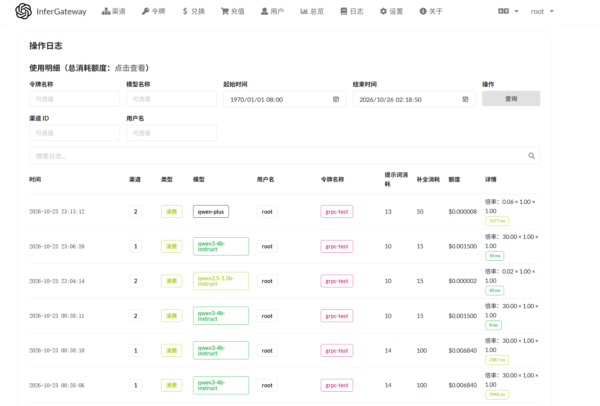

# InferGateway

一个 LLM API 网关，把多家大模型厂商（OpenAI / Claude / Gemini / 阿里云百炼 / 自建 vLLM 等）统一成 OpenAI 兼容协议，提供 HTTP 和 gRPC 双入口、按 token 计费配额、以及针对自建推理服务的多实例编排（健康检查 + 加权负载均衡 + 故障切换）。

## 特性

- **多厂商适配**：OpenAI、Claude、Gemini、阿里云百炼、Azure、自建 vLLM 等 40+ 厂商，统一 `/v1/chat/completions` 接口
- **HTTP + gRPC 双入口**：HTTP 兼容 OpenAI SDK，gRPC 供内部微服务高效调用
- **推理服务编排**：针对自建 vLLM 多实例，健康检查 + 加权负载均衡 + 故障自动切换
- **计费配额**：tiktoken 预扣 + 真实 usage 后扣，按模型/分组倍率计费，令牌级配额管理
- **渠道分发**：按用户分组 + 模型 + 优先级选渠道，支持主备渠道与自动禁用
- **管理后台**：Web UI 管理渠道、令牌、用户、日志、系统配置
- **MySQL 持久化 + Redis 缓存**：渠道配置内存缓存定时同步，用户余额 Redis 实时读写

## 界面预览

**系统状态**（名称 / 版本 / 源码仓库 / 运行配置）：



**渠道管理**（多厂商渠道配置：阿里云百炼 + 自建 vLLM）：



**调用日志**（真实调用记录：模型 / 提示词消耗 / 补全消耗 / 倍率 / 耗时）：



## 架构

```
            ┌─────────────────────────────────────────┐
            │                  调用方                    │
            │     业务后端 / 微服务 / curl / SDK         │
            └────────────────┬──────────────────────────┘
                             │
        ┌────────────────────┴────────────────────┐
        │ HTTP /v1/* (Gin :3000)    gRPC :50051   │
        └────────────────────┬───────────────────┘
                             │
        ┌────────────────────┴───────────────────┐
        │       鉴权 + 选路层                     │
        │  HTTP: Distribute (按 group+model 选渠道) │
        │  gRPC: 编排层 LB.Pick (按健康度选实例)    │
        └────────────────────┬───────────────────┘
                             │
        ┌────────────────────┴───────────────────┐
        │     relay / adaptor 转发层              │
        │  工厂选 adaptor → 转发 → 计费          │
        └────────────────────┬───────────────────┘
                             │
   ┌─────────────────────────┴─────────────────────────┐
   │                                                   │
┌──┴──────────────┐                         ┌───────────┴────────┐
│  厂商渠道池     │                         │  自建 vLLM 实例池    │
│ OpenAI/Claude/  │                         │ health checker 探活 │
│ Gemini/百炼...  │                         │ balancer 加权随机   │
└─────────────────┘                         └─────────────────────┘
```

两条入口在 **relay/adaptor 转发层**汇合，共用一套计费和适配逻辑，但选路策略不同：HTTP 走 `Distribute`（按 group 选厂商渠道），gRPC 走编排层 `LB.Pick`（按健康度选 vLLM 实例）。

## 快速开始

### 环境要求

- Go 1.27+
- MySQL 8.0+
- （可选）Redis 6.0+
- （可选，自建推理）vLLM + GPU

### 启动

```bash
# 1. 准备数据库
mysql -u root -p -e "CREATE DATABASE infergateway CHARACTER SET utf8mb4;"

# 2. 启动网关
SQL_DSN="root:pwd@tcp(localhost:3306)/infergateway?charset=utf8mb4&parseTime=True&loc=Local" \
INFERGATEWAY_INSTANCES="http://localhost:8000,1;http://localhost:8001,1" \
go run .

# 3. （可选）启动备用 mock 实例，演示 failover
go run ./cmd/fakevllm -port 8001
```

启动后访问 `http://localhost:3000`，用 root/123456 登录管理后台配置渠道。

### 调用示例

**HTTP**（OpenAI 兼容）：
```bash
curl http://localhost:3000/v1/chat/completions \
  -H "Authorization: Bearer sk-<你的令牌>" \
  -H "Content-Type: application/json" \
  -d '{"model":"qwen-plus","messages":[{"role":"user","content":"你好"}],"max_tokens":50}'
```

**gRPC**（编排层 + failover）：
```bash
go run ./cmd/grpcclient -addr localhost:50051 \
  -token "sk-<你的令牌>" -model qwen3-4b-instruct -prompt "你好"
```

## 核心模块

| 模块 | 位置 | 职责 |
|------|------|------|
| **gRPC 入口** | `grpc/server.go` | ChatCompletion 复用 relay 链 + failover 重试；ListChannels 返回实例状态 |
| **推理编排层** | `infergateway/` + `health/` + `balancer/` | orchestrator 单例加载实例池；health checker 每 10s 并发 ping、连续 3 次失败标 DOWN、自动恢复；balancer 加权随机 Pick + Failover |
| **relay 转发链** | `relay/` | Adaptor 接口 + GetAdaptor 工厂 + RelayTextHelper 主流程（HTTP/gRPC 共用） |
| **鉴权选路** | `middleware/` | TokenAuth 验令牌塞 ctxkey；Distribute 按 group+model 选渠道 |
| **管理后台** | `web/` + `controller/` | Web UI + REST API 管理 channels/tokens/users/logs |

## 编排层工作原理

只对 gRPC 链生效。三个模块协作：

- **orchestrator**：单例，从 `INFERGATEWAY_INSTANCES` 环境变量加载 vLLM 实例列表，启动 health checker，创建 balancer
- **health checker**：goroutine 每 10s 并发 ping 各实例 `/health`，连续 3 次失败标 DOWN（抖动过滤），恢复后自动转回 HEALTHY，RWMutex 保护状态
- **balancer**：`Pick()` 加权随机选健康实例；`Failover(inst)` 标 DOWN + 重 Pick，请求返 5xx/超时触发

两种失败检测互补：HC 周期 ping 捕获静默挂，Failover 请求失败即时标。4xx 不标不重试（请求本身问题）。

## 技术栈

- **Go** 1.27 + **Gin** (HTTP) + **grpc-go** (gRPC)
- **GORM** + **MySQL 8.0**
- **Redis**（用户余额实时读写）
- **tiktoken**（OpenAI BPE，预扣 quota 用）
- **vLLM**（自建推理，Qwen3-4B-AWQ INT4 + Prefix Caching + FlashAttention-2）

## 项目结构

```
InferGateway/
├── main.go                # 程序入口
├── proto/                 # gRPC proto 定义（增量）
├── grpc/                  # gRPC server（增量）
├── infergateway/          # 推理编排层 - orchestrator（增量）
├── health/                # 健康检查（增量）
├── balancer/              # 负载均衡（增量）
├── cmd/                   # fakevllm + grpcclient 验证工具（增量）
├── router/                # 路由装配
├── middleware/            # 鉴权 + 选路 + 限流
├── controller/            # HTTP 入口 + 管理面
├── relay/                 # 转发核心
├── model/                 # GORM 模型 + 内存缓存
└── web/                   # 前端管理面
```

## 详细文档

- [代码导航与流程映射](代码导航_流程与文件映射.md) — 端到端流程每一步对应的代码文件和函数

## License

MIT